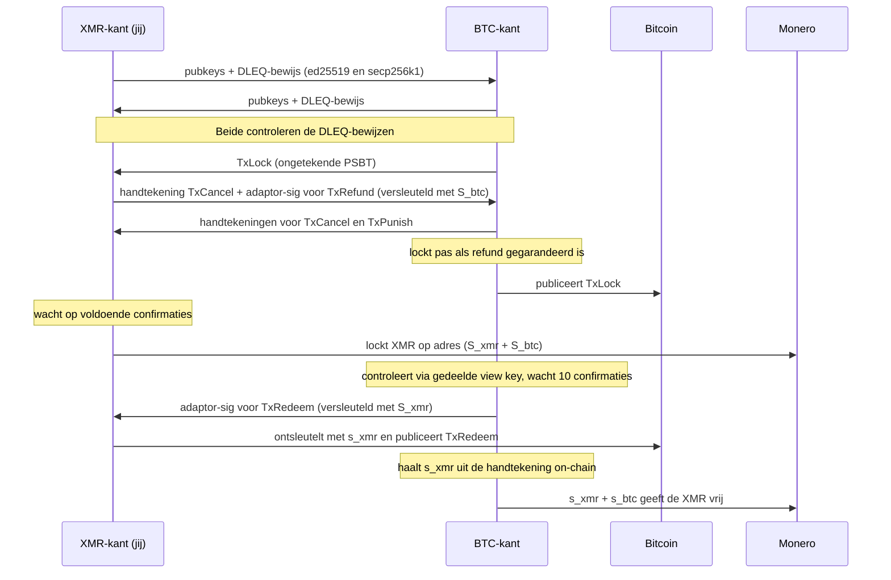
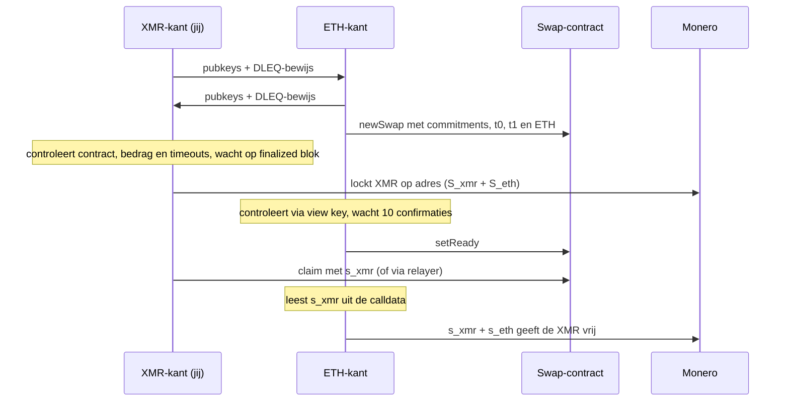

# 2. Hoe een XMR ⇄ BTC/ETH atomic swap werkt

## Het kernprobleem
Monero heeft geen scripts: er bestaan geen hashlocks of timelocks zoals bij Bitcoin. Een klassieke HTLC-swap werkt daarom niet. De oplossing (Gugger, 2020) bestaat uit drie onderdelen:

1. **Sleutel splitsen op Monero.** De XMR gaat naar een adres waarvan de private spend key `s = s_xmr + s_ander` is. Elke partij kent maar één helft, dus niemand kan de XMR alleen uitgeven.
2. **De andere chain dwingt het af.** Op BTC/ETH regel je dat het opnemen van de BTC/ETH de *helft van de Monero-sleutel* van die partij onthult:
   - **BTC:** met *adaptor signatures*. Een "versleutelde" handtekening wordt pas geldig als je hem ontsleutelt met je geheime sleuteldeel. Zodra die geldige handtekening on-chain staat, kan de tegenpartij jouw geheim eruit afleiden.
   - **ETH:** het smart contract eist bij `claim(s)` letterlijk het geheime scalar `s`, en dat staat daarna publiek in de calldata.
3. **Cross-group DLEQ-bewijs.** Monero gebruikt ed25519, Bitcoin en Ethereum gebruiken secp256k1. Elke partij bewijst dat haar sleuteldeel op beide curves *hetzelfde getal* is. Zonder dit bewijs kan een tegenpartij een "nep"-sleutel gebruiken en verlies je je XMR. **Dit bewijs moet je altijd controleren.**

## Gouden regel: de chain met scripts lockt eerst
In alle bestaande protocollen (eigenwallet, BasicSwap, AthanorLabs) lockt de **BTC/ETH-kant eerst** en de **XMR-kant als tweede**. Voor jou als XMR-verkoper betekent dat:

- ✅ Je lockt je XMR pas als de BTC/ETH aantoonbaar (en definitief) vastligt.
- ⚠️ Na je XMR-lock moet je **online zijn** om de BTC/ETH op tijd op te halen, vóór de cancel-timelock (BTC) of vóór `t_1` (ETH).
- ⚠️ Mis je dat venster, dan is er geen ramp: de tegenpartij refundt, onthult daarbij haar sleuteldeel, en jij haalt je XMR terug. Wel heb je dan tijd en fees verloren.

### Let op: namen Alice/Bob verschillen per project
| | XMR-verkoper (jij) | BTC/ETH-kant |
|---|---|---|
| Gugger / eigenwallet (BTC) | **Alice** (maker, `asb`) | **Bob** (taker, `swap`) |
| AthanorLabs (ETH) | **Bob** | **Alice** |

In dit project gebruiken we daarom **"XMR-kant"** en **"BTC-kant"/"ETH-kant"**, en nooit Alice/Bob.

---

## Protocol A: XMR ⇄ BTC (Gugger-protocol, zoals eigenwallet)

**Transacties op Bitcoin** (allemaal vooraf ondertekend tijdens de setup):

| Tx | Wie publiceert | Wanneer | Effect |
|---|---|---|---|
| `TxLock` | BTC-kant | start | BTC naar 2-van-2 multisig |
| `TxRedeem` | XMR-kant | na XMR-lock | XMR-kant krijgt BTC → **onthult `s_xmr`** |
| `TxCancel` | iedereen | na cancel-timelock `T1` (eigenwallet: 30 blokken ≈ 5 u) | zet BTC in een nieuwe 2-van-2 |
| `TxRefund` | BTC-kant | na `TxCancel` | BTC terug → **onthult `s_btc`** |
| `TxPunish` | XMR-kant | `T2` na cancel (eigenwallet: 144 blokken ≈ 24 u) | XMR-kant krijgt BTC als de BTC-kant niet refundt |

**Wat kan er misgaan, en wat gebeurt er dan?**
- **De XMR-kant lockt nooit XMR.** De BTC-kant wacht tot `T1`, doet `TxCancel` en `TxRefund` en heeft alles terug.
- **De BTC-kant stuurt geen redeem-handtekening.** Na `T1` volgt `TxCancel`. De BTC-kant refundt en onthult daarbij `s_btc`, waarmee de XMR-kant haar XMR terughaalt.
- **De BTC-kant refundt niet vóór `T2`.** Dan doet de XMR-kant `TxPunish` en krijgt de BTC. De XMR blijft vastzitten, tenzij de XMR-kant vrijwillig `s_xmr` deelt ("cooperative redeem").
- **De XMR-kant redeemt te laat (na `TxCancel`).** `TxRedeem` is dan ongeldig, en het verloop wordt de refund-route hierboven.

## Protocol B: XMR ⇄ ETH (gebaseerd op AthanorLabs)

**Voorgesteld contract** (eigen ontwerp naar het voorbeeld van AthanorLabs' `SwapCreator`): één contract voor alle swaps, met per swap een struct. De functies:

- `newSwap(claimCommitment, refundCommitment, claimer, t0, t1, value)`: de ETH-kant lockt ETH (of een ERC-20).
- `setReady(swap)`: de ETH-kant geeft aan dat de XMR klopt.
- `claim(swap, s)`: de XMR-kant ontvangt de ETH en onthult daarmee `s_xmr`.
- `refund(swap, s)`: de ETH-kant krijgt ETH terug en onthult daarmee `s_eth`.
- Het contract controleert `s·G == commitment` op secp256k1 met de goedkope *ecrecover-truc*. Dankzij het DLEQ-bewijs is dat dezelfde `s` als op ed25519.

**Timeouts** (AthanorLabs-semantiek):
- **Vóór `setReady` en vóór `t_0`** mag de ETH-kant refunden, bijvoorbeeld als de XMR-lock niet klopt.
- **Na `setReady`, of na `t_0`, en vóór `t_1`** mag alleen de XMR-kant claimen.
- **Na `t_1`** mag de ETH-kant refunden. Dat onthult `s_eth`, zodat de XMR-kant haar XMR terughaalt.

**Twee ETH-specifieke punten:**
1. **Gas.** Wie alleen XMR heeft, heeft geen ETH voor `claim()`. Bouw `claimRelayer`: de XMR-kant ondertekent een EIP-712-bericht en een relayer dient het in tegen een kleine fee uit de swap.
2. **Race rond `t_1`.** `claim` en `refund` kunnen elkaar in de mempool kruisen. Claim dus **ruim** vóór `t_1`, met een marge van minimaal enkele uren.

---

## Marktrol ≠ protocolrol: wie plaatst de offer?

"Wie eerst lockt" (protocol) staat los van "wie de offer plaatst" (markt). Voor een XMR-verkoper zijn er twee productvormen:

| | **Vorm 1: jij bent maker** | **Vorm 2: jij bent taker** |
|---|---|---|
| Hoe het werkt | Jij publiceert koersen en kopers met BTC/ETH komen naar jou | Jij kiest een offer van een maker die BTC/ETH heeft |
| Lijkt op | eigenwallet **asb** | eigenwallet-**app**, maar omgekeerd. BasicSwap "reversed" |
| Wie lockt eerst | de koper (taker) | de maker (op jouw verzoek) |
| Probleem | jij moet 24/7 online zijn | **free option / griefing**: jij kunt de maker laten locken en dan afhaken. Makers willen daar bescherming tegen. |
| Moeilijkheid | lager (protocol is bewezen) | hoger (anti-spam nodig, bijv. upfront fee, reputatie of rate-limits) |

**Advies:** bouw één state machine voor de *XMR-kant*, die voor beide marktrollen werkt (zoals Farcaster). Begin met de **taker-UI** (vorm 2), omdat je een eigenwallet-achtige app wilt. Zorg vanaf dag 1 dat de **maker-kant** (BTC/ETH-houder) beschermd is: rate-limits, een maximumbedrag per onbekende peer, en optioneel een kleine anti-spam-fee. Een gratis swap-aanvraag die een lock afdwingt is een DoS-vector.
