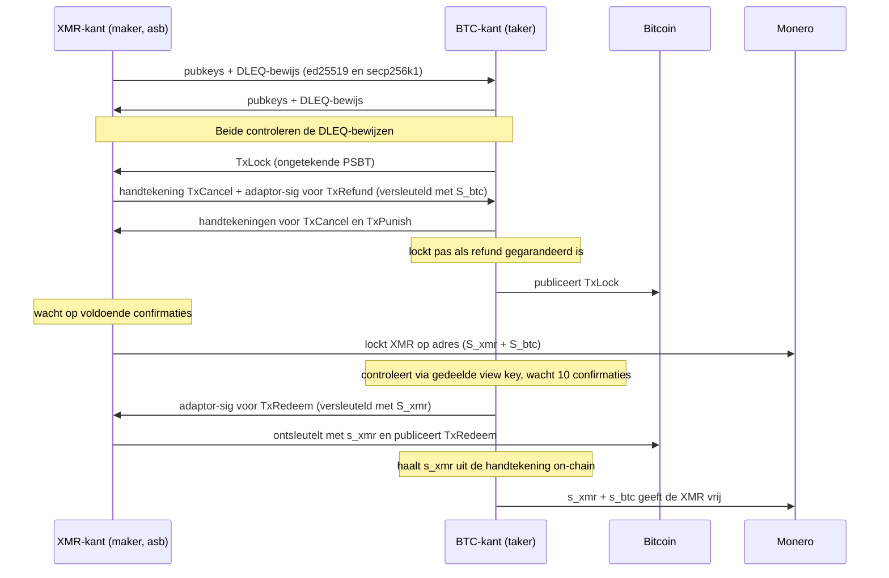
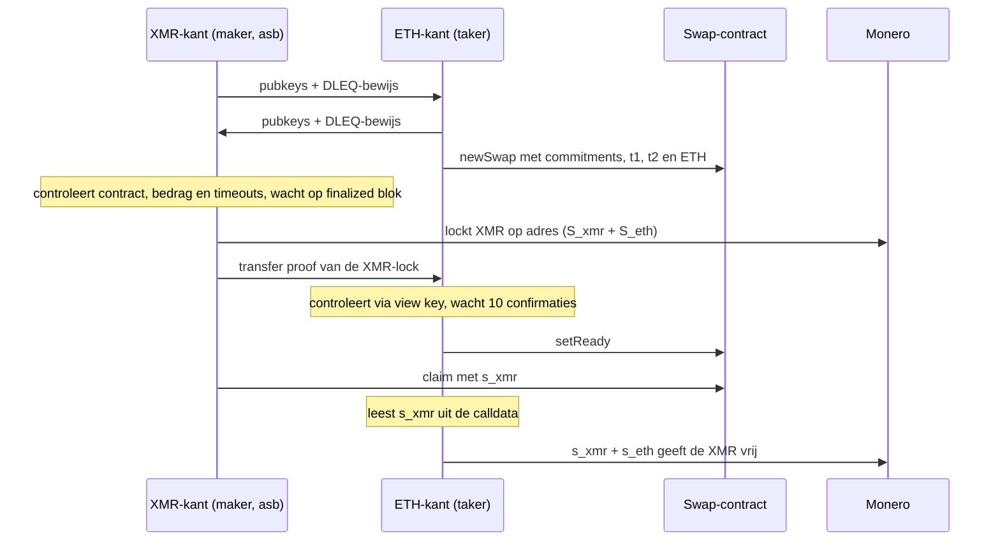

# 2. Hoe een XMR ⇄ BTC/ETH atomic swap werkt

## Het kernprobleem
Monero heeft geen scripts: er bestaan geen hashlocks of timelocks zoals bij Bitcoin. Een klassieke HTLC-swap werkt daarom niet. De oplossing (Gugger, 2020) bestaat uit drie onderdelen:

1. **Sleutel splitsen op Monero.** De XMR gaat naar een adres waarvan de private spend key `s = s_xmr + s_ander` is. Elke partij kent maar één helft, dus niemand kan de XMR alleen uitgeven.
2. **De andere chain dwingt het af.** Op BTC/ETH regel je dat het opnemen van de BTC/ETH de *helft van de Monero-sleutel* van die partij onthult:
   - **BTC:** met *adaptor signatures*. Een "versleutelde" handtekening wordt pas geldig als je hem ontsleutelt met je geheime sleuteldeel. Zodra die geldige handtekening on-chain staat, kan de tegenpartij jouw geheim eruit afleiden.
   - **ETH:** het smart contract eist bij `claim(s)` letterlijk het geheime scalar `s`, en dat staat daarna publiek in de calldata.
3. **Cross-group DLEQ-bewijs.** Monero gebruikt ed25519, Bitcoin en Ethereum gebruiken secp256k1. Elke partij bewijst dat haar sleuteldeel op beide curves *hetzelfde getal* is. Zonder dit bewijs kan een tegenpartij een "nep"-sleutel gebruiken en verlies je je XMR. **Dit bewijs moet je altijd controleren.**

## Gouden regel: de chain met scripts lockt eerst
In alle bestaande protocollen (eigenwallet, BasicSwap, AthanorLabs) lockt de **BTC/ETH-kant eerst** en de **XMR-kant als tweede**. In deze fork is de XMR-kant de **maker** (`asb`, dat ben jij) en de BTC/ETH-kant de **taker** (de app-gebruiker). Voor de maker betekent dat:

- ✅ Je lockt je XMR pas als de BTC/ETH aantoonbaar (en definitief) vastligt.
- ⚠️ Na je XMR-lock moet je **online zijn** om de BTC/ETH op tijd op te halen, vóór de cancel-timelock (BTC) of vóór `t_1` (ETH).
- ⚠️ Mis je dat venster, dan is er geen ramp: de tegenpartij refundt, onthult daarbij haar sleuteldeel, en jij haalt je XMR terug. Wel heb je dan tijd en fees verloren.

### Let op: namen Alice/Bob verschillen per project
| | XMR-kant = maker (jij) | BTC/ETH-kant = taker |
|---|---|---|
| Gugger / eigenwallet (BTC) | **Alice** (maker, `asb`) | **Bob** (taker, `swap`) |
| AthanorLabs (ETH) | **Bob** | **Alice** |

In dit project gebruiken we daarom **"XMR-kant"** en **"BTC-kant"/"ETH-kant"**, en nooit Alice/Bob.

---

## Protocol A: XMR ⇄ BTC (Gugger-protocol, zoals eigenwallet)

**Transacties op Bitcoin** (allemaal vooraf ondertekend tijdens de setup):

| Tx | Wie publiceert | Wanneer | Effect |
|---|---|---|---|
| `TxLock` | BTC-kant | start | BTC naar 2-van-2 multisig |
| `TxRedeem` | XMR-kant | na XMR-lock | XMR-kant krijgt BTC → **onthult `s_xmr`** |
| `TxCancel` | iedereen | na cancel-timelock `T1` (eigenwallet: 30 blokken ≈ 5 u) | zet BTC in een nieuwe 2-van-2 |
| `TxRefund` | BTC-kant | na `TxCancel` | BTC terug → **onthult `s_btc`** |
| `TxPunish` | XMR-kant | `T2` na cancel (eigenwallet: 144 blokken ≈ 24 u) | XMR-kant krijgt BTC als de BTC-kant niet refundt |

**Wat kan er misgaan, en wat gebeurt er dan?**
- **De XMR-kant lockt nooit XMR.** De BTC-kant wacht tot `T1`, doet `TxCancel` en `TxRefund` en heeft alles terug.
- **De BTC-kant stuurt geen redeem-handtekening.** Na `T1` volgt `TxCancel`. De BTC-kant refundt en onthult daarbij `s_btc`, waarmee de XMR-kant haar XMR terughaalt.
- **De BTC-kant refundt niet vóór `T2`.** Dan doet de XMR-kant `TxPunish` en krijgt de BTC. De XMR blijft vastzitten, tenzij de XMR-kant vrijwillig `s_xmr` deelt ("cooperative redeem").
- **De XMR-kant redeemt te laat (na `TxCancel`).** `TxRedeem` is dan ongeldig, en het verloop wordt de refund-route hierboven.

## Protocol B: ETH → XMR (contract naar eigenwallet-model)

Het contract volgt de **semantiek van eigenwallet**, niet die van AthanorLabs. Zie de toelichting onder de tabel.

**Voorgesteld contract** (`contracts/SwapCreator.sol`): één contract voor alle swaps, met per swap een struct.

| Functie | Wie | Toegestaan wanneer | Onthult | Vergelijkbaar met (BTC) |
|---|---|---|---|---|
| `newSwap(...)` | taker | start: ETH in het contract, met commitments op beide secp256k1-pubkeys, `t1`, `t2`, en het vaste maker-adres | – | `TxLock` |
| `setReady(id)` | taker | nadat de taker de XMR-lock heeft gecontroleerd, vóór `t1` | – | encsig sturen |
| `claim(id, s_maker)` | maker | na `setReady`, vóór `t1` | `s_maker` → de taker krijgt de XMR | `TxRedeem` |
| `refund(id, s_taker)` | taker | vóór `setReady`, **of** na `t1` | `s_taker` → de maker krijgt zijn XMR terug | `TxCancel` + `TxRefund` |
| `punish(id)` | maker | na `t2` als er nog niets is afgewikkeld | niets | `TxPunish` |

- Het contract controleert `s·G == commitment` op secp256k1 met de goedkope *ecrecover-truc*. Dankzij het DLEQ-bewijs is dat dezelfde `s` als op ed25519. Het bestaande DLEQ-bewijs van eigenwallet (secp256k1 ↔ ed25519) is daarvoor direct bruikbaar.
- Uitbetaling gaat altijd naar de **vooraf vastgelegde** adressen (de maker bij claim en punish, de taker bij refund), nooit naar `msg.sender`.

**Waarom niet het AthanorLabs-model?** Bij AthanorLabs mag de XMR-kant na `t0` ook *zonder* `setReady` claimen. Dan moet de ETH-kant vóór `t0` online zijn om een foute of ontbrekende XMR-lock te zien en te refunden. Een oneerlijke maker zou anders ETH kunnen pakken zonder XMR te locken, terwijl de taker de app dicht heeft. In het eigenwallet-model betaalt de taker pas na een **actieve bevestiging** (`setReady`, net als het sturen van de encsig bij BTC). De taker loopt alleen risico als hij langer dan `t2` offline blijft, en dan refundt de app automatisch zodra hij weer draait. Dat is hetzelfde risicoprofiel als eigenwallet nu heeft.

**Wat kan er misgaan?**
- **De maker lockt nooit XMR.** De taker refundt (vóór `setReady`), onthult `s_taker`, en dat schaadt niemand.
- **De XMR-lock klopt niet.** De taker roept geen `setReady` aan maar refundt. De maker haalt eventueel gelockte XMR terug met `s_taker`.
- **De maker claimt niet vóór `t1`.** De taker refundt na `t1` en de maker haalt zijn XMR terug.
- **De taker doet niets tot `t2`.** De maker punisht en krijgt de ETH. De XMR blijft vastzitten, tenzij de maker vrijwillig `s_maker` deelt (cooperative redeem, zoals bij BTC).

**ETH-specifieke punten:**
1. **Gas.** De maker roept `claim()` aan en heeft daarvoor ETH nodig. Na de eerste swap heeft de maker ETH, dus houd een kleine gas-buffer aan in de asb-wallet en laat de asb waarschuwen als die te laag wordt. Een relayer is in deze richting niet nodig.
2. **Races rond `t1`.** `claim` en `refund` kunnen elkaar rond `t1` in de mempool kruisen. De maker claimt dus **direct** na `setReady`, en de maker lockt alleen XMR als er nog ruim tijd is tot `t1`.
3. **Finality.** De maker lockt pas XMR na een **finalized** blok (~13 min) met de `newSwap`.

---

## Gekozen marktrol: net als eigenwallet

"Wie eerst lockt" (protocol) staat los van "wie de offer plaatst" (markt). Er waren twee opties:

| | **Gekozen: XMR-kant is maker** | Niet gekozen: XMR-kant is taker |
|---|---|---|
| Hoe het werkt | De maker (`asb`) publiceert koersen. Takers met BTC/ETH kiezen een maker en locken eerst. | De taker met XMR laat een BTC/ETH-maker eerst locken. |
| Voorbeeld | eigenwallet | BasicSwap "reversed" |
| Probleem | De maker moet 24/7 online zijn. Takers kunnen liquiditeit vastzetten (eigenwallet gebruikt een anti-spam-borg). | Free option en griefing tegen de maker. Een apart protocol is nodig. |

Deze fork gebruikt de eerste optie, dus alles wat eigenwallet al heeft blijft bruikbaar: de rendezvous-discovery, quotes, de anti-spam-borg, de `asb` en de `asb-controller`.
